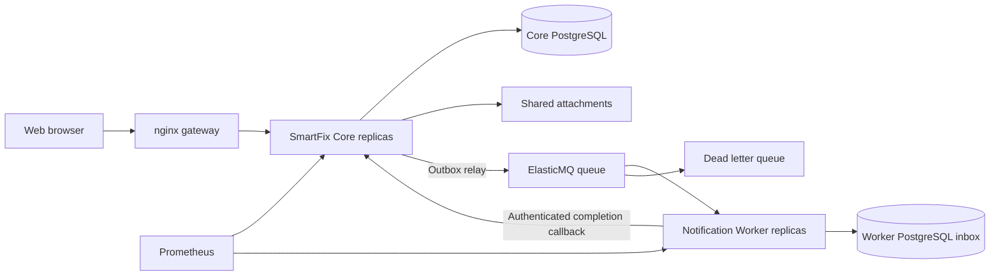

# SmartFix — SWE5001 Cloud-Native Architecture

**English** | [简体中文](README.zh-CN.md)

**SWE5001 — Architecting Scalable Systems Practice (NUS-ISS)**

Branch: [`swe5001-cloud-native`](https://github.com/Lian9374/smartfix/tree/swe5001-cloud-native)

SmartFix is a campus facility maintenance application for requesters, administrators
and technicians. This branch evolves the SWE5006 implementation into a distributed
**Core + Notification Worker MVP**, focusing on service boundaries, asynchronous
communication, horizontal scaling, monitoring and deployment automation.

**Current status:** the distributed system runs locally, with verified functional,
multi-replica and reliability tests. AWS infrastructure and deployment scripts are
prepared, but **a real AWS deployment has not been executed**. Remaining course work
includes cloud evidence, fuller design views, the presentation and the formal report.

## Start here

- [Complete Chinese implementation, running and demonstration guide](docs/swe5001/README.zh-CN.md)
- [Architecture, service boundaries, consistency and decisions](docs/swe5001/architecture.md)
- [Executed verification, measurements and limitations](docs/swe5001/verification.md)

## What changed for SWE5001

- **Independent services:** Spring Boot Core and a Python notification Worker have
  separate images, runtimes and dependency sets. Worker owns its database/inbox and
  does not query Core business tables.
- **Asynchronous delivery:** Core transactional outbox → SQS-compatible queue →
  Worker → authenticated Core callback, with idempotency and retry handling.
- **Core scale-out:** nginx balances requests across Core replicas; JDBC sessions
  and attachments are shared across replicas.
- **Observability:** Prometheus collects Core/Worker metrics. Recorded load tests
  include latency, throughput, errors, CPU, memory and queue backlog.
- **Automation:** GitHub Actions builds and verifies the distributed environment.
  A separate approval-gated workflow prepares AWS image publishing and deployment.

Request, Dispatch, Work Order and SLA remain bounded contexts inside Core. They have
**not** been extracted into four independent microservices. The working web interface
and business rules are reused from SWE5006.

## Local architecture



ElasticMQ is the local SQS protocol simulator. Actual managed-cloud deployment is
still pending; see the [target cloud architecture](docs/swe5001/architecture.md#physical-aws-architecture).

## Run this branch locally

Prerequisites: Git and Docker Desktop with Compose. The optional E2E script needs
Python 3; direct Java development uses JDK 21 and Maven 3.9+.

```bash
git clone --branch swe5001-cloud-native --single-branch https://github.com/Lian9374/smartfix.git smartfix-swe5001
cd smartfix-swe5001
cp .env.swe5001.example .env
docker compose -f compose.swe5001.yml up -d --build --wait --wait-timeout 300
```

After initial startup is healthy, enable the two-Core/two-Worker demo:

```bash
docker compose -f compose.swe5001.yml up -d --no-build --scale core=2 --scale worker=2 --wait --wait-timeout 180
```

- Application: <http://localhost:8080/>
- Gateway readiness: <http://localhost:8080/healthz>
- Prometheus: <http://localhost:9090/>
- Optional local email viewer: <http://localhost:8025/>; email delivery is disabled by default.

Local administrator: `demo.admin` / `SmartFixDemo1!`; select **Administrator** at login.
These are isolated teaching credentials. Create requester/technician accounts through
the administrator interface or the optional E2E script:

```bash
python3 scripts/swe5001/e2e.py
```

E2E creates demo accounts and a real maintenance request. Load tests create many
records; isolate test data before repeating them. Opening the website does not
require running a load test. Stop while retaining data with:

```bash
docker compose -f compose.swe5001.yml down
```

## Verification and remaining work

Recorded verification includes **991 Java tests and 8 Worker tests**, the integrated
three-role workflow, shared sessions/attachments and real PostgreSQL/HTTP fault tests.
See the [regression record](results/pr-quality-followup.json) and
[successful GitHub verification run](https://github.com/Lian9374/smartfix/actions/runs/39253386866).
These records do not independently confirm the latest SonarCloud gate.

[Historical local load measurements](results/benchmark-summary.json) compare one and
two Core replicas. These short tests mainly exercise request submission against a
recorded earlier image; they do not establish production capacity, full-workflow
load performance or automatic cloud scaling.

Real managed-cloud deployment/release evidence, fuller DDD/design material, the final
PPT and the formal report remain outstanding. Local Compose needs no AWS account.
Cloud deployment requires separate credentials and cost approval; AWS templates
are preparation, not proof of successful cloud operations.

## Repository navigation

- `src/main/java/com/smartfix/cloud/` — distributed relay, callback and security.
- `services/notification-worker/` — independent notification service and tests.
- `contracts/` — versioned event contract.
- `compose.swe5001.yml`, `infra/local/` — local distributed environment.
- `infra/aws/` — proposed managed-cloud infrastructure.
- `scripts/swe5001/` — E2E, load, reliability, metrics and deployment tools.
- `.github/workflows/swe5001-*.yml` — verification and deployment workflows.
- `docs/swe5001/` — implementation, architecture and verification documentation.

## SWE5006 baseline and original engineering handbooks

The preserved SWE5006 baseline is
[`6cb329f`](https://github.com/Lian9374/smartfix/tree/6cb329f4fe9b1f7e2e708b9ee00d81c456740fc0).
Its modular-monolith architecture and Sprint handbooks describe the original course
version. They remain accessible at that fixed revision:

- [Original SWE5006 English README](https://github.com/Lian9374/smartfix/blob/6cb329f4fe9b1f7e2e708b9ee00d81c456740fc0/README.md)
- [Original SWE5006 Chinese README](https://github.com/Lian9374/smartfix/blob/6cb329f4fe9b1f7e2e708b9ee00d81c456740fc0/README.zh-CN.md)
- [SWE5006 baseline architecture](https://github.com/Lian9374/smartfix/blob/6cb329f4fe9b1f7e2e708b9ee00d81c456740fc0/docs/architecture.md)

Continue SWE5001 changes on `swe5001-cloud-native`. Keep the SWE5006 `main` version
separate; a SWE5001 hand-in does not require merging the two course versions.
