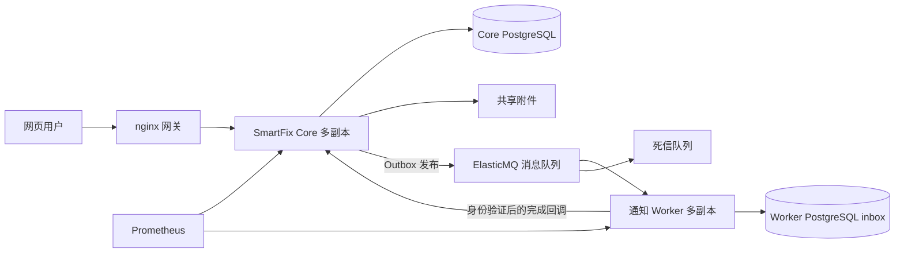

# SmartFix — SWE5001 云原生架构实践

[English](README.md) | **简体中文**

**SWE5001 — Architecting Scalable Systems Practice（NUS-ISS）**

当前分支：[`swe5001-cloud-native`](https://github.com/Lian9374/smartfix/tree/swe5001-cloud-native)

SmartFix 是面向报修用户、管理员和维修人员的校园设施维护系统。本分支在 SWE5006
业务实现的基础上，完成 **Core + Notification Worker 两服务 MVP**，重点展示服务边界、
异步通信、横向扩容、监控与部署自动化。

**当前状态：本地分布式系统已可运行，功能、多副本和消息可靠性已有验证。AWS 基础设施
与部署脚本已准备，但尚未执行真实 AWS 部署。** 课程交付仍需补齐托管云实证、设计材料、
最终 PPT 和正式项目报告。

## 从这里开始

- [完整实现、运行与演示手册](docs/swe5001/README.zh-CN.md)
- [架构、服务边界、一致性与设计决策](docs/swe5001/architecture.md)
- [实际验证、测量结果与限制](docs/swe5001/verification.md)

## SWE5001 新增了什么

- **两个独立服务**：Spring Boot Core 与 Python 通知 Worker 拥有各自的镜像、运行进程
  和依赖；Worker 拥有独立数据库／inbox，不直接查询 Core 业务表。
- **异步通知**：Core 事务 outbox → SQS 兼容队列 → Worker → 受保护的 Core 回调，
  通过去重与事务边界处理重复消息和重试。
- **Core 多副本**：nginx 负载均衡、共享 JDBC Session 和附件存储，使同一登录会话
  可以访问不同 Core 副本。
- **监控与扩容实验**：Prometheus 采集 Core／Worker 指标；保存延迟、吞吐、错误率、
  CPU、内存及队列积压的真实本地测量。
- **自动化**：GitHub Actions 构建和验证整个分布式环境；另外提供受分支、环境和费用批准
  保护的 AWS 镜像发布与部署流程。

Request、Dispatch、Work Order 和 SLA 仍是 Core 内的业务上下文，**没有拆成四个独立
微服务**。原有网页和业务规则被复用，因此网站外观可以与 SWE5006 相似；本课程新增成果
主要在架构、服务运行方式和工程验证。

## 当前本地架构



ElasticMQ 是本地 SQS 协议模拟器，不能作为已运行 AWS 托管服务的证据。
目标云架构另见[架构说明](docs/swe5001/architecture.md#physical-aws-architecture)。

## 在本地运行 SWE5001

准备 Git 和 Docker Desktop（含 Compose）。可选 E2E 脚本需要 Python 3；在本机直接开发
Java 时使用 JDK 21、Maven 3.9+。

```bash
git clone --branch swe5001-cloud-native --single-branch https://github.com/Lian9374/smartfix.git smartfix-swe5001
cd smartfix-swe5001
cp .env.swe5001.example .env
docker compose -f compose.swe5001.yml up -d --build --wait --wait-timeout 300
```

首次环境健康后，启用双 Core、双 Worker 演示：

```bash
docker compose -f compose.swe5001.yml up -d --no-build --scale core=2 --scale worker=2 --wait --wait-timeout 180
```

- 网站：<http://localhost:8080/>
- 网关就绪状态：<http://localhost:8080/healthz>
- Prometheus：<http://localhost:9090/>
- 可选本地邮件查看器：<http://localhost:8025/>；邮件投递默认关闭。

本地管理员：`demo.admin` / `SmartFixDemo1!`，登录时选择 **Administrator**。
这些是隔离教学环境的默认凭据。可通过管理员页面创建报修用户和维修人员，也可运行可选 E2E：

```bash
python3 scripts/swe5001/e2e.py
```

E2E 会创建演示账户和一条真实报修记录。压测会创建大量记录，重跑前应隔离测试数据；
只打开网站不需要运行压测。已有环境的演示账户说明见[完整手册](docs/swe5001/README.zh-CN.md)。
停止服务并保留数据：

```bash
docker compose -f compose.swe5001.yml down
```

## 已有验证与剩余工作

验证记录包括 **991 项 Java 测试、8 项 Worker 测试**，三角色业务链路、共享会话／附件，
以及真实 PostgreSQL／HTTP 故障场景。参见
[完整回归记录](results/pr-quality-followup.json)和
[成功的 GitHub 完整验证](https://github.com/Lian9374/smartfix/actions/runs/39253386866)。
这些记录尚未独立确认最新 SonarCloud 门禁结果，不能据此宣称 PR 所有检查均已通过。

[历史本地压测](results/benchmark-summary.json)比较了 1／2 个 Core；它是记录过的早期镜像、
短时间、以报修提交为主的实验，不能据此宣称生产容量、完整维修链路压测或云自动扩容已经验证。

尚需完成托管云和云发布实证、更完整的 DDD／设计视图、最终 Presentation 与正式项目报告。
本地 Compose 不要求 AWS 账户；真实云部署需另行配置账户并确认费用。AWS 模板属于部署准备，
尚不代表云上运行已成功。

## 文件导航

- `src/main/java/com/smartfix/cloud/`：分布式 relay、完成回调与内部接口安全。
- `services/notification-worker/`：独立通知服务与测试。
- `contracts/`：版本化事件契约。
- `compose.swe5001.yml`、`infra/local/`：本地分布式环境。
- `infra/aws/`：目标托管云基础设施。
- `scripts/swe5001/`：E2E、压测、可靠性、指标和部署工具。
- `.github/workflows/swe5001-*.yml`：验证与部署流水线。
- `docs/swe5001/`：实现、架构和验证文档。

## SWE5006 基线与原工程手册

保留的 SWE5006 基线是
[`6cb329f`](https://github.com/Lian9374/smartfix/tree/6cb329f4fe9b1f7e2e708b9ee00d81c456740fc0)。
其中的 Modular Monolith 与 Sprint 说明属于原课程版本；可从固定版本查看：

- [原 SWE5006 英文 README](https://github.com/Lian9374/smartfix/blob/6cb329f4fe9b1f7e2e708b9ee00d81c456740fc0/README.md)
- [原 SWE5006 中文 README](https://github.com/Lian9374/smartfix/blob/6cb329f4fe9b1f7e2e708b9ee00d81c456740fc0/README.zh-CN.md)
- [SWE5006 基线架构](https://github.com/Lian9374/smartfix/blob/6cb329f4fe9b1f7e2e708b9ee00d81c456740fc0/docs/architecture.md)

SWE5001 后续更新继续放在 `swe5001-cloud-native`。SWE5006 的 `main` 版本保持独立，
不需要为了 SWE5001 提交而合并两个课程版本。
