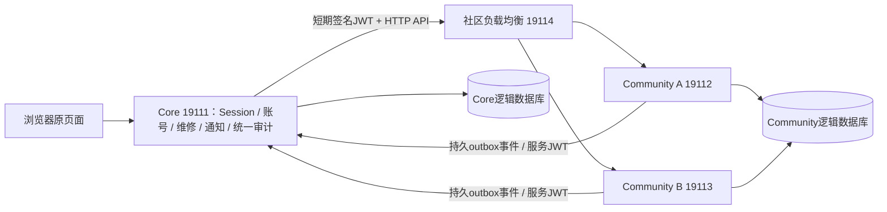

# SmartFix最终交付核对

2026-10-29；基于迁移分支，不合并main、不推送、不切换真实流量。
实现核对起点：`674a355c00c0eb7814e5e2dbb9bb433e71906728`。本阶段仅新增验证脚本和交付文件，不改业务代码。

## 四项分别结论

- 架构：Core保留账号/维修等模块化边界，Community抽离为独立业务微服务。独立进程、启动入口、JAR、逻辑库、角色、Flyway及发布；同一仓库、同一宿主机/PG容器不妨碍这个代码和部署边界，但共享资源仍是限制。
- 功能：阶段6/8有完整社区、三角色维修、图片、通知、审计、历史链接和跨JVM正确性证据；用户已确认阶段1–9对应人工验收。阶段10当前产物15项实时检查通过，120项Java/6项Python定向测试通过；当前构建浏览器验收尚待明确确认，不把本次“执行第十一阶段”当成确认。
- 恢复：阶段7已验证无新写入回退和新增写入后恢复到新单体库；本阶段从原逻辑备份再次恢复到全新19121/15493，校验原始行数、真实启动和三角色登录/页面。它与19090/15443相互独立。不存在的历史附件读取为N/A。
- 性能：用户取消完整234轮和精简12轮剩余实验；没有完整同版本1/2/3实例、API/完整页面对比，不能宣称水平扩容收益或老师的Scalability要求已得到实测证明。最大持续容量、垂直扩容、自动扩缩容均未验证。

## 服务与数据边界

Core拥有users、账号状态/安全版本/强制改密、维修与附件、站内通知及投递任务、统一审计和inbox。Community拥有问题、回答、采纳、举报、审核、本地审计、发帖守卫、命令幂等、聚合序列及outbox；只保存外部账号ID，不建跨服务users外键。社区内部外键与采纳约束保留。

远程Core的`RemoteCorePersistence`排除社区实体/Repository及旧通知监听器，启动断言检查实际Bean；旧社区表应用角色不可写。保留的旧表供备份/历史兼容，不是隐藏的社区业务直连入口。作者显示名由Core批量补齐，每批最多50，不从Community回调查账号。统一审计按来源标识去重、全局稳定排序分页，保留USER/DELIVERY/SLA等来源。

## 实际API、身份和一致性

早期phase2文件是当时设计记录，不能直接当作实现接口说明。以下以当前源码为准：

- 页面仍经过Core原控制器与模板，Session、ActiveAccountFilter、角色、强制改密及CSRF继续生效；客户端userId/role不作为服务端身份。
- Community主接口为`POST /internal/community/v1/operations/{operation}`；读操作也使用POST。读有browse/myQuestions/myAnswers/detail/ownAnswer/thread/reports/openCount；写有ask、editQuestion、withdrawQuestion、answer、editAnswer、withdrawAnswer、accept、removeAcceptance、reportQuestion、reportAnswer、resolve、hideQuestion、restoreQuestion、hideAnswer、restoreAnswer。
- 分页实际返回`content/page/size/total`，不是phase2草案的items字段。错误主要为`COMMUNITY_400/403/404/409`及可选message；Core映射回原表单语义，依赖不可用或结果未知为503。不是草案全部细分code都已实现。
- Core签发RS256、kid=stage4-core-1、issuer=smartfix-core、audience=smartfix-community，sub为账号ID，带role/securityVersion/passwordChangeRequired，最长30秒、5秒时钟容差。Community验证签名及claims后，独立判断角色、作者、隐藏内容与管理员权限。账号限制由Core每次入口检查；已签发凭证有短期有效窗口，不声称即时跨服务撤销。
- 写请求`Idempotency-Key`为UUID，按actor+operation+key和内容摘要去重，同键不同内容409。守卫行首次创建与`FOR UPDATE`锁在Community库内，数据库跨JVM串行化同用户写入，保留频率/重复内容限制。重试使用原表单键；不自动生成新键重复写。不存在一个已部署的通用`/commands/lookup`草案接口，早期最小链路的专用查询不等于通用接口。
- Core调用并发上限8，连接500ms、读取2000ms；无可用槽位快速503。社区故障隔离对维修的实测见阶段8，不能扩大为任意负载保证。
- 事件实际类型为CommunityAnswerCreated、CommunityAnswerAccepted、CommunityContentHidden、CommunityAuditRecorded。恢复/撤回不会误发隐藏通知；合法再采纳产生新事件。审核本地审计与业务、幂等结果、outbox同事务。
- 信封保存eventId、traceId、producer、eventType、schemaVersion=1、aggregateType=QUESTION、aggregateId、aggregateSequence、occurredAt和payload。审计payload实际使用auditId/actorUserId等字段，以`LocalAuditService`和`CommunityEventReceiver`为准，不照抄草案sourceAuditId字段。
- 发布器用另一对非对称密钥，issuer=smartfix-community、audience=smartfix-core-events、subject=community-publisher，调用`POST /internal/community-events/v1/events`。15秒持久租约、SKIP LOCKED领取、同问题顺序、确认CAS、失败重试；250ms调度，每轮最多32项且2秒预算。Core同事务写inbox及通知/审计，提交后确认，重复事件不重复生效。这是至少一次加幂等，不是跨库分布式事务或外部邮件exactly-once。

当前仅回环HTTP、固定kid，本地密钥文件；生产TLS、网络策略、密钥轮换和长期协议演进没有验证。不得据此直接公开Community端口或投产。

## 构建、独立发布和证据索引

阶段3建立两个应用/数据库；阶段4身份与本地发帖锁；阶段5回答/通知最小链路；阶段6全社区和审计；阶段7数据恢复；阶段8双真实JVM、故障隔离、兼容Community单独发布；阶段9方案及低量smoke；阶段10发布器及Cookie修复。对应提交列表及证据摘要在EVIDENCE.json。

阶段8单独发布测试是兼容诊断资源更新，不证明不兼容接口版本切换。阶段10两JAR产物、摘要、定向测试与真实PostgreSQL七组回归见`../phase10/EVIDENCE.json`和`VALIDATION.md`。本阶段再次核对磁盘JAR摘要和实际进程路径，检查重启后的服务标识，不把历史PID当作现在的PID。

完整源码测试集未重跑；特定PostgreSQL测试硬编码其他阶段端口，未盲目运行。阶段8完整回归是当时构建的证据，本阶段使用当前产物做登录/页面/Cookie复核，不冒称把所有旧故障测试再执行一遍。

## 恢复和原版保护

本阶段重新核对原项目/备份各4421文件摘要、main与ready标签；只读检查原数据库和19090保护容器ID/挂载/运行状态。备份逻辑转储从未覆盖，向全新stage11容器恢复；复制代码/配置到独立目录，使用已验证原版JAR、独立上传目录、Cookie和邮件关闭配置。原表行数在新增合成账号前逐项与原备份比较。

本阶段恢复使用阶段1已构建的原版JAR，并记录摘要；未重新构建原目录，也未把微服务JAR冒充原版。原项目配置8080不是实时可用的证明，原始smartfix-db当前状态与本地8080探测单列于EVIDENCE；AWS入口未查询。

阶段7在可丢弃数据库演练：暂停旧写入并排空→最终同步和通知水位→单一Community权威→无新写回退→新增写后拒绝过期回退→双库归档→新恢复库导入最新社区状态/审计/通知并修正序列。对stage9新增数据不能直接运行固定stage7脚本；真实增量回迁是另行任务，Git回退不恢复数据库/附件。

## 性能观察及限制

原发布器每秒只领1项，在20业务迭代/秒且10%写的运行中积压302项、最老约183秒，是实际定位的问题。已改有界批量发布并通过正确性回归；没有足够的完整对比证明新版本容量或扩容收益。

驱动器还修复Windows计时精度和每请求创建HTTPS上下文的CPU开销；旧驱动或旧产物运行保留并单独标记，不能混合挑选好结果。精简计划仅完成两个单实例点，第三点被用户中止，没有完整三实例组，也不计算Qn/Sn/En或把未运行填0。

Community水平复制：两个真实进程和负载分发/故障摘除已验证，1/2/3性能收益NOT_RUN_COMPLETE。Core仍单实例，状态会话、多Core扩容与维修模块独立扩容未实现。垂直扩容未实测；自动扩缩容未实现。共用宿主机和PG服务器，LB为实验Python进程，不能代表生产高可用或云端收益。AWS A/B未执行，原云环境未替换。外发邮件/SLA自动升级、长稳、生产灾备RPO/RTO未验证。

## 三张操作卡和验收状态

使用[A原版](A_ORIGINAL.md)、[B微服务](B_MICROSERVICES.md)、[C只停实验版](C_STOP_EXPERIMENT.md)。逐项人工路径见B卡，19121另验三角色及备份历史问题/回答；再确认19090可登录。自动演练只停四个实验应用、19090持续可用，再恢复19111–19114。

当前可交付本地微服务演进实现及真实证据，不能对老师承诺性能已达标。第十一阶段自动复核结果见EVIDENCE.json；最终浏览器验收未确认时保持PENDING_USER。没有下一主线阶段，不自动合并、推送、云部署或切流。
