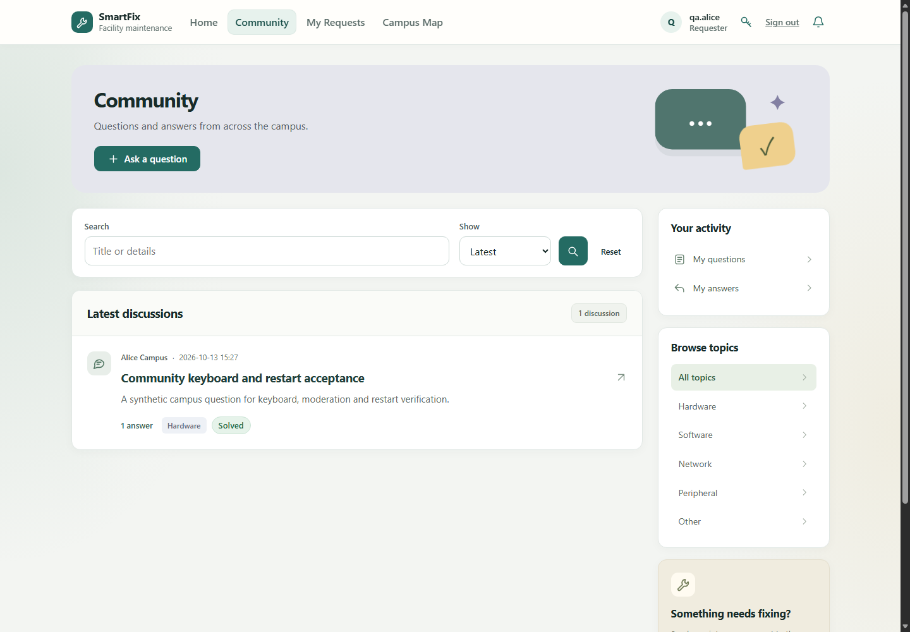
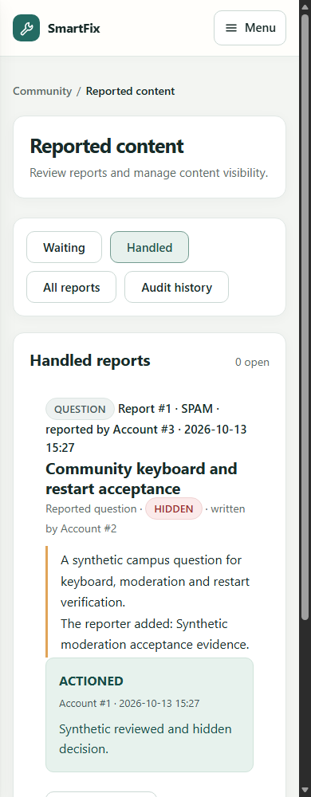
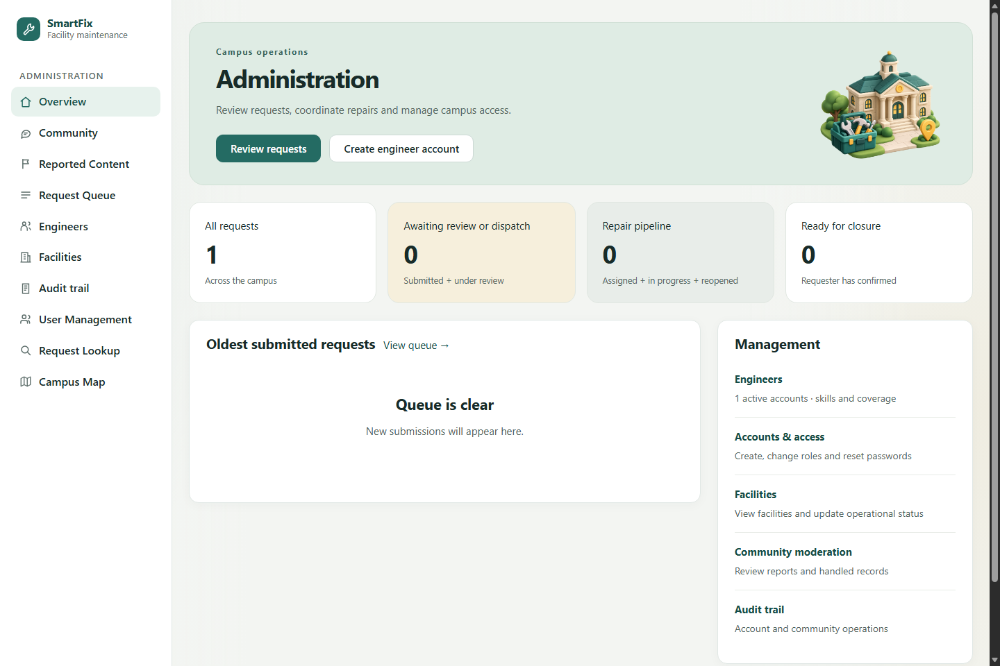
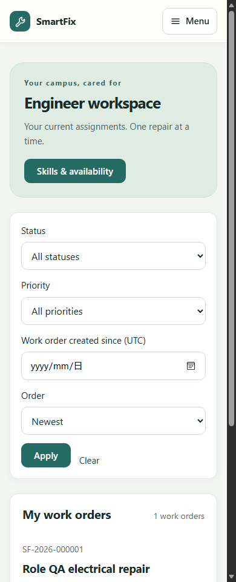

# UserA Sprint 4 发布验收与质量收口

日期：2026-10-13。分支：`feature/sprint4-usera-release-quality`。

## 发布结论

**UserA 的本地代码整改、可自动执行的验收与文档交付已完成；全范围正式发布条件尚未全部关闭。**

本轮修复后的编译、完整默认测试、原生 PostgreSQL 测试、社区与全角色浏览器链路均通过。真实手机／读屏、B/C/D/E 评审和 SLA／邮件／可靠投递遗留仍需各自闭环；AWS 未部署、未验收。具体门禁见 [验收清单](Release_Acceptance_Checklist_CN.md) 和 [已知问题](Known_Issues_CN.md)。

## 1. 基线与可追溯性

- 保留原有本地未提交 README／Sprint 4 计划，创建新分支后纳入文档交付，未 reset 或覆盖用户工作。
- 合并核查时最新 `origin/main`（`023b1ef`），同时保留本地已有 `940b69d` 迁移兼容修复。
- 最后一次生产源码变更提交为 `eb89a71`；验收脚本的角色首页断言修复提交为 `67d5e8a`。后续文档／结果提交不改变被测生产源码。
- 全角色流程在 `eb89a71` 工具版本执行；社区和最终非空页面布局在 `67d5e8a` 工具版本执行。两者都使用同一个固定 jar，不把工具修正前后的 Git SHA 写成完全相同。
- 被测 jar SHA-256：`90706e99ea211bb6b9b37fa79bba20d95a9f378f29a30941e2055297d4031b4d`。
- JSON 记录各次实际 `sourceCommit`、工作树源码指纹、产物哈希及源码改动状态。最终社区与布局证据对应同一工作树指纹；完整角色流程的工具指纹不同，但生产产物一致。
- 临时 jar、日志、独立数据库和测试密码只保留在忽略的 `target/`；不提交真实凭据、业务数据或应用包。

## 2. 实际整改

### 全站键盘进入正文

共享签入页面的 sidebar 片段提供 Skip to main content，键盘焦点时显示；`accessibility.js` 将焦点放到 `#main-content`，不额外占用正常 Tab 顺序。无脚本仍保留原生锚点跳转。

保持现有青绿／薄荷／米色、卡片布局、插图和上下文 New request 入口，不重新设计已认可页面。复用既有减少动画偏好规则，不重复定义。

### 社区输入与操作反馈

社区 POST 表单展示可被辅助技术读取的 Saving 状态、设置忙碌标记、阻止同一表单的重复提交，并在浏览器前进／后退恢复时清除状态。保留取消确认、提交按钮携带的数据、服务端验证、CSRF 和业务保护。

这不是服务器幂等机制或可靠投递实现；实时字符计数仍作为字段说明，不在每个按键上发 live alert。

### 注册实际阻塞修复

首次完整回归出现 9 个失败：匿名 `POST /register` 在 SecurityConfig 没有被允许，提交被跳转到登录页。新增该精确 POST 路由的匿名授权，保留 CSRF、注册限流和服务端固定 REQUESTER。

未放开管理接口／账号前缀，未新增身份系统，未修改迁移或密码设计。既有注册提权、无 CSRF、校验和限流测试随完整回归重新通过。此跨模块最小修复需 B 在整合时复核。

### 验收工具

- 两个浏览器脚本支持独立 Sprint 4 输出目录，不覆盖 Sprint 3 证据。
- 增加源码／产物身份记录；角色结果只有脚本完整结束才标记通过，避免仅凭之前的成功检查误报。
- 社区脚本改为依据真实角色验证登录落点：REQUESTER `/`、ADMINISTRATOR `/admin`、TECHNICIAN `/technician`，不改变产品跳转行为。
- 角色验收增加报表、公告、通知和地图的 HTTP／多宽度检查；最后在已产生真实测试记录的非空页面复查布局。

## 3. 实际执行与结果

### 编译与完整默认验证

`mvn -o -DskipTests compile`：BUILD SUCCESS。

`mvn -o -B verify`：最终 BUILD SUCCESS；489 个单元／服务测试、259 个默认集成测试，共 748 项，失败、错误和跳过均为 0。

首次完整回归的 9 个失败已定位为注册路由授权缺失并修复；没有删除测试或降低预期来绕过错误。

### 原生 PostgreSQL

独立 PostgreSQL 16.11 集群仅监听 `127.0.0.1:55441`，使用新建 `smartfix_release_test`，每个测试按既有规则隔离 schema；未操作业务库。

实际命令：

```powershell
mvn -o -B -Ppostgres-it "-Dtest=TechnicianDirectoryServiceTest" `
  "-Dit.test=*PostgresIT,MigrationIT,AttachmentPersistenceIT,RequestMigrationIT,AssignmentMigrationIT" verify
```

BUILD SUCCESS；13 个定向单元回归和 120 个原生数据库测试全部通过，无失败、错误或跳过。它是选定全部原生数据库测试类的运行，不宣称原样执行了不带筛选的完整 profile；默认测试已在前一步独立完整执行。

覆盖空库／旧库迁移、升级保留、初始化并发、活动派单约束、撤回／改派失权、工单生命周期、附件、社区采纳／处理并发和建筑目录等现有测试。

隔离测试日志中仍可见通知监听错误（默认 H2 的 SQL 兼容异常及部分原生工单夹具的 NullPointerException），测试断言未失败。正常社区 PostgreSQL 浏览器通知及重启保持已通过；不能由这些结果声称投递失败恢复已解决。E/C 仍应核对日志与夹具覆盖，见已知问题。

### 社区真实浏览器

`node tools/verify-community-browser.mjs`：**108 项检查全部通过，330 次键盘动作，2 次应用启动**。

真实 Edge + `smartfix_community_acceptance_test`，Tab／Enter／Space／方向键操作；验证提问、编辑、回答、采纳、举报、处理隐藏、Handled 恢复入口、正式审计及通知。

停止首个测试 JVM 再启动，核对问题正文、回答、采纳、处理决定、恢复可见性、回答／采纳通知仍保留。服务器返回校验错误后，真实脚本将焦点移至首个无效字段。

检查标题／ID／label／aria-describedby／脚本错误，实际文字对比度抽样及 1440/1000/768/390/320px 无整页横向溢出。新 Skip 链接的键盘聚焦已验证。

证据：[完整结果](evidence/usera/community/browser-results.json)。

### 全角色真实浏览器

`node tools/verify-role-workspaces-browser.mjs`：**122 项检查通过**。

创建工程师 → 临时密码登录 → 强制设置新密码并重新登录 → 配置技能／覆盖／可用性 → 普通用户注册和报修 → 管理员审核／派单 → 工程师记录维修／提交解决 → 用户确认 → 管理员关闭。

同时验证真实管理页面、用户／设施／工程师目录、报表、公告、通知和地图的多宽度布局。这里只证明报表／地图等入口可访问与布局，不等同于其全部业务统计或在线瓦片服务都经过功能认证。

`ROLE_ACCEPTANCE_LAYOUT_ONLY=true` 再运行同一脚本：**56 项检查通过**，针对已含账号与关闭工单记录的非空页面复核。不是第二次完整业务链路。

证据：[完整角色结果](evidence/usera/roles/results.json)、[最终非空布局结果](evidence/usera/roles/results-layout.json)。

### 语法与证据检查

所有应用顶层静态 JavaScript、修改的验收工具执行 `node --check`；`git diff --check` 通过。文档相对链接检查和三个浏览器结果的产物哈希一致性检查见 [机器汇总](evidence/usera/verification-summary.json)。

没有 React／npm 前端构建步骤。人工查看本轮生成的桌面／手机视口截图；手机视口不是物理手机。

## 4. 过程失败如实记录

- 初始普通沙箱下测试 JVM／PostgreSQL 初始化挂起；仅停止本次已识别测试进程，在允许子进程的执行环境重跑。挂起运行不计为通过。
- 社区首次启动时传错测试数据库凭据变量；修正为 COMMUNITY_ACCEPTANCE_DB_USERNAME／PASSWORD 后重跑，不修改应用认证。
- 社区脚本旧 `/` 断言误报管理员登录失败；系统实际正确进入 `/admin`。修正断言，保留失败测试库，再创建同名新的空验收库完成最终链路。
- 完整默认验证的注册失败按第 2 节修复，最终完整重跑通过。

## 5. 未完成的人工／团队门禁

实际手机与实际读屏尚未操作，不声称完整 WCAG 认证。人工补证时至少记录：设备／系统／浏览器，Tab 进入正文和导航，表单必填／校验提示，保存与恢复反馈，列表状态文字和地图替代信息，截图及问题处置。

团队评审、SLA／邮件／可靠投递遗留，以及 AWS 的真实部署均未由本轮关闭。既有规则和未定项见 [规则索引](Decision_Register_CN.md)。

## 6. 复跑与演示

先准备独立 `_test` 数据库、构建 jar。测试脚本拒绝普通业务库名称；重复完整社区运行应准备新的空验收库，不要清空业务库来复跑。

```powershell
# 凭据由本地环境提供，不写进仓库；以下只列变量名。
# 社区：COMMUNITY_ACCEPTANCE_DB_URL / DB_USERNAME / DB_PASSWORD（均带 COMMUNITY_ACCEPTANCE_ 前缀）
$env:COMMUNITY_ACCEPTANCE_OUTPUT='docs/sprint4/evidence/usera/community'
node tools/verify-community-browser.mjs

# 角色：ROLE_ACCEPTANCE_DB_URL、TEST_DB_USERNAME、TEST_DB_PASSWORD
$env:ROLE_ACCEPTANCE_OUTPUT='docs/sprint4/evidence/usera/roles'
node tools/verify-role-workspaces-browser.mjs
```

复跑覆盖结果前，应按版本保留需留档证据。可用 COMMUNITY_ACCEPTANCE_JAR／ROLE_ACCEPTANCE_JAR 固定同一 jar；默认使用 target 下构建产物。

演示按第 3 节两条真实链路执行，不提供固定管理员账号密码、不操作真实用户内容。

## 截图








