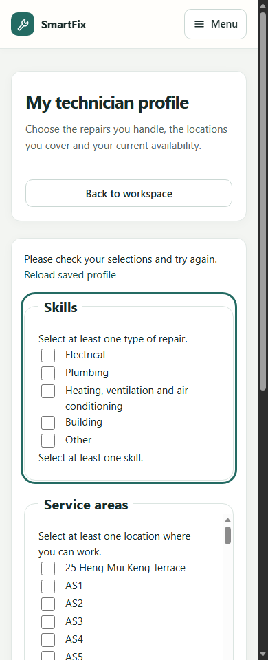

# UserB Sprint 4 账号权限、派单与限流交接

日期：2026-10-13。分支：`feature/sprint4-userb-access-dispatch`。基于 UserA 已推送的 `7ef6865` 创建，保留全部既有代码、迁移及证据。

## 结论

UserB 本轮应用代码整改和可执行验收已完成。没有新增角色、身份系统、数据库迁移或 AWS 配置。真实设备／读屏、SLA／邮件／可靠通知和其他成员任务仍按各自交接关闭，不能由本交接宣布全范围正式发布。

生产修改在 `13bd107` 和 `f207e05`。完整角色链路在前者运行；后者补充管理员目录服务检查并完成最终单元回归及非空页面布局复查。各证据记录实际源码提交、工作树指纹和 jar 哈希；后续仅文档／证据提交不改变被测代码。

## B-01 账号和资源权限

### 新增服务层保护

已有 ActiveAccountFilter 会检查数据库中的角色、状态、security_version 和 password_change_required；临时密码账号必须先进入 `/account/password`，业务 POST 被拒绝。

本轮把相同既有规则补到 B 的服务边界：

- AssignmentService：未完成密码设置的管理员不能通过直接服务调用 assign／reassign／withdraw。
- DispatchPageService：未完成密码设置的管理员不能直接读取派单详情。
- TechnicianDirectoryService：工程师尚须改密码时不能直接读取／修改自己的工作档案；管理员读取工程师目录也要处于 ACTIVE、ADMINISTRATOR 且已完成密码设置状态，空操作人被拒绝。

在读取档案／修改派单之前拒绝，保留账户和工单数据。新增 tests 验证拒绝后没有产生新指派，也没有替换当前有效指派；目录拒绝发生在加载 profiles 前。

这是现有“先完成密码设置”的多层执行，不是新业务规则。管理重置和工程师创建继续使用原有 AccountAdministrationService／UserService，不增加邀请／邮件或管理员自助注册。

### 已有能力复核

- 注册仅绑定普通用户字段，服务端固定 REQUESTER；伪造角色／账号状态／security_version 不提权。
- 后端管理接口拒绝普通用户与工程师，不依赖页面隐藏。
- 停用和角色变更使旧会话在下一次请求失效；密码重置要求管理员密码，标记强制改密并更新会话版本。
- 无 CSRF 的写请求被拒；未映射路由保持 denyAll。
- 工程师私有工单／附件按当前有效指派检查，改派／撤回后失权；资源隐藏按项目现有 404 规则执行。

证据来自真实服务／MockMvc 安全集成和 PostgreSQL 测试，不将浏览器导航当作唯一授权检查。

## B-02 派单稳定性

复用 Assignment 的活动指派唯一约束、版本号、expectedAssignmentId 和既有生命周期。没有更改迁移或派单条件。

回归包含首次派单、两个管理员竞争、重复派单、改派、撤回、过期表单、事务回滚、无资格工程师、休假／停用／技能或覆盖不匹配、开始维修后的改派及历史保留。

真实 PostgreSQL 用 AssignmentPostgresIT／DispatchPagePostgresIT 的继承案例验证，不把 H2 模拟唯一索引等同于 PostgreSQL 部分唯一索引。新增管理员密码状态案例也在真实库执行。

原页面已有冲突 409、重新加载、禁止复用过期指派以及撤回确认；本轮保留。没有将派单失败当成功，也没有让工程师获得全站管理能力。

## B-03 注册限流

RegistrationRateLimiter 继续 synchronized 原子预留、按真实连接来源和单进程全局窗口限流；不信任任意 X-Forwarded-For、不因新 Session 重置额度。

修复两项等待时间边界：

1. 同时达到地址额度和全局额度时，Retry-After 取两者需要等待的较大值，避免返回一个尚不能重试的短等待时间。
2. 地址桶容量满时，按最早可释放桶的最后一次预留到期时间计算等待，而不是无条件再等整个窗口。不得驱逐未过期桶来重置别人额度。

新增并发多来源测试验证全局限额；原同来源并发、滚动窗口、四舍五入向上及地址洪泛保护测试继续通过。等待秒数计算避免 `millis + 999` 的额外加法溢出。

### 配置（保持原默认值）

application.yml 明确映射，并在 `.env.example` 仅登记非秘密参数：

- `SMARTFIX_REGISTRATION_MAX_PER_ADDRESS=5`：每个来源窗口内可预留尝试数。
- `SMARTFIX_REGISTRATION_WINDOW=PT1H`：来源滚动窗口。
- `SMARTFIX_REGISTRATION_MAX_GLOBAL_PER_MINUTE=100`：本进程每分钟额度。
- `SMARTFIX_REGISTRATION_MAX_ADDRESSES=4096`：来源桶上限。

参数必须为正；尝试在验证和密码哈希之前预留，非法表单也计入。429 保留真实 Retry-After。配置无须 Redis 或新表。

Spring Boot 不自动读取 `.env`，主机启动需导出变量；现有 Compose 不会自动转发这四个参数，部署负责人须显式配置。本轮未修改容器／代理配置。

### 不能宣称的能力

限流仍是单进程内存状态，重启清空、多实例不共享。代理后可能所有请求表现为同一来源。未来部署必须明确信任代理／真实来源并配置入口限流；这里没有开启对任意转发头的信任，没有认证分布式防刷。

## B-04 页面、日志和错误反馈

工程师配置页的 Skills／Service areas／Availability 只在实际有错误时引用相应错误节点；设置组错误状态与可编程焦点，避免 aria-describedby 指向未渲染内容。

真实浏览器发送空配置表单，服务器返回 400，动态加载真实错误页面后，首个无效 fieldset 获得焦点；标签和说明引用完整。320–1440px 均无整页横向溢出。

保留登录页“不自动夺取初始焦点”、统一密码设置、已有保存／冲突提示、确认交互及 UserA 的视觉规范。没有修改共享 CSS 或批量覆盖 UserA 页面。

本轮没有新增密码／令牌日志，验证脚本只记录合成数据的结果／截图／指纹，不输出认证 cookie。日志和测试密码保留在忽略的 target，交付证据不包含真实凭据。

## 实际验证

以下为定向 UserB 验证，不声称重跑完整全仓库套件。UserA 的 748 项完整默认结果仍是先前版本历史证据。

### 第一轮模块验证

```powershell
mvn -o -B "-Dtest=RegistrationRateLimiterTest,TechnicianDirectoryServiceTest" `
  "-Dit.test=AuthenticationFlowIT,RegistrationFlowIT,RegistrationRateLimitIT,RoleWorkspacesIT,AssignmentIT,DispatchPageIT,TechnicianProfileIT" verify
```

BUILD SUCCESS：21 个单元测试、114 个模块集成测试，无失败／错误／跳过。随后增加的管理员目录服务单元案例在最终回归执行；新增派单页直接服务密码状态案例也在下一轮 PostgreSQL 子类执行。

### 真实 PostgreSQL

独立 PostgreSQL 16.11，`127.0.0.1:55442`，新建 `smartfix_userb_test`。各类隔离 schema，不修改业务库。

```powershell
mvn -o -B -Ppostgres-it `
  "-Dtest=RegistrationRateLimiterTest,TechnicianDirectoryServiceTest,TechnicianRecommendationServiceTest,UserBootstrapServiceTest" `
  "-Dit.test=AssignmentPostgresIT,AssignmentMigrationIT,DispatchPagePostgresIT,TechnicianAccessPostgresIT,AccountInitializationPostgresIT,RegistrationConcurrencyPostgresIT" verify
```

BUILD SUCCESS：41 个定向单元回归、64 个真实数据库测试，无失败／错误／跳过。

### 最终补强版本

```powershell
mvn -o -B "-Dtest=RegistrationRateLimiterTest,TechnicianDirectoryServiceTest" -DskipITs package
mvn -o -DskipTests compile
```

最终 22 个单元回归及打包通过；编译通过。该 package 明确跳过集成测试，不能把它计为另一轮集成测试成功；集成结果分别来自上述两轮。

### 真实浏览器

独立 `smartfix_role_acceptance_test`、临时 Edge profile；设置 `ROLE_ACCEPTANCE_USERB=true` 运行现有角色脚本：**135 项检查通过**。

覆盖角色工作台、管理员创建工程师、临时密码设置、配置覆盖／技能、报修、审核／派单、维修、用户确认和关闭；新增工程师直接请求 `/admin`、`/admin/users`、`/admin/requests` 返回 403，以及配置页真实校验与焦点／说明关联。

最终补强版本用 `ROLE_ACCEPTANCE_LAYOUT_ONLY=true` 对已含数据页面复核：**56 项检查通过**。不是另一轮完整业务链路。

证据：[完整角色／UserB 检查](evidence/userb/roles/results.json)、[最终非空布局](evidence/userb/roles/results-layout.json)、[机器结果](evidence/userb/verification-summary.json)。各次产物和源码身份分别记录，不把两次 jar 当成相同产物。

修改的验收脚本执行 node --check；git diff --check 和文档链接检查通过。没有额外前端框架构建或新数据库迁移。

## 复跑

按项目测试指南配置专用 TEST_DB_URL／USERNAME／PASSWORD；不能用业务库作测试。浏览器变量：

```powershell
# 凭据通过本地环境提供；ROLE_ACCEPTANCE_DB_URL 须为脚本允许的本机专用验收库。
$env:ROLE_ACCEPTANCE_OUTPUT='docs/sprint4/evidence/userb/roles'
$env:ROLE_ACCEPTANCE_USERB='true'
node tools/verify-role-workspaces-browser.mjs
```

完整链路与 layout-only 要分别留结果；可通过 ROLE_ACCEPTANCE_JAR 指定被测 jar。证据应记录实际版本，不覆盖其他成员的材料。

## 仍需其他工作包关闭

AWS／入口限流／代理与共享会话不在本轮。实际手机、实际读屏、完整无障碍认证及正式团队批准未执行。E 的可靠通知／SLA／邮件和 C/D 的其他任务不会因本轮权限测试通过而自动完成。


