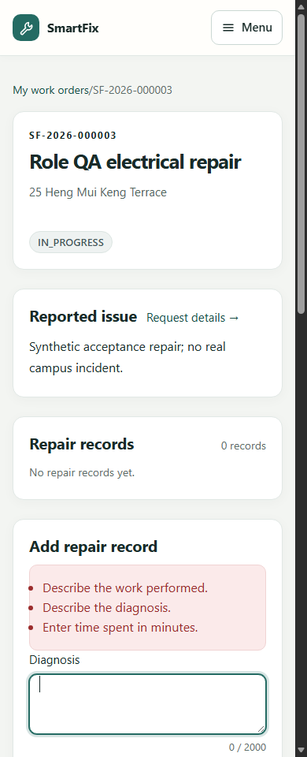

# UserC Sprint 4 迁移、生命周期与工单稳定性交接

日期：2026-10-13。分支：`feature/sprint4-userc-migration-workflow`，基于 UserB `81af386` 创建。

## 结论

本轮 C 的代码、迁移复验、并发与工单页面整改及交接完成。核心实现 `367cc4f`，导航隔离修复 `984355a`，最终字段提示整改 `43a6d8e`；后续文档／证据提交不改变被测代码。

没有操作业务库、修改历史 SQL、关闭 Flyway 校验或新增迁移；没有改变既有状态机、角色、SLA 时限或派单规则。全范围正式发布仍需其他工作包及 AWS 单独验收。

## C-01 数据库发布保障

复用已有 `940b69d` 的兼容回调和 V25，在独立 PostgreSQL 16.11 重新验证：

- 空 schema 全链迁移与严格 validate，重复 migrate 无新增执行。
- 历史分支遗漏迁移的受控恢复及工程师／派单／通知／请求数据保留。
- V14/V20 通知重叠结构协调与 V25。
- 非法旧数据导致整体回滚，不留半成功迁移。
- 未知较早版本和额外外键依赖被拒，原有数据及历史不被清空。

恢复模式仅处理已登记的 10/11/14/16 历史遗漏，正常模式严格校验；没有在用户业务库执行 repair/clean/恢复。

见 [迁移登记](Migration_Register_CN.md) 与 [机器文件快照](evidence/userc/migration-manifest.json)。当前 23 个 SQL 文件，最高 V25，13/15 未发布。文件 SHA-256 不等同于 Flyway CRC32。

## C-02 迁移编号协调

本轮无需 SQL：历史已有主键和初始历史部分唯一索引。新版本按最新最高值之后申请，V26 起没有预留给任何模块。

E 的可靠投递／SLA／邮件和 D 的索引如需 SQL，先核查集成分支及共享环境历史，登记用途、依赖、负责人和验证，再实施。不能因旧计划写 V13 就把新 SLA 插回已运行 V25 的历史。

## C-03 生命周期与权限

### 初始历史并发

recordInitialSubmission 先检查操作人，再在写事务内锁定请求行，检查历史后保存。并发调用最终一个成功、另一方 BusinessConflictException，避免依靠唯一索引异常暴露数据库细节。V6 唯一约束仍是数据库最后保护。

新增测试在隔离夹具中模拟缺失初始历史，验证一个历史、一个提交事件和正确主键，不处理业务库真实记录。

### 服务权限

把 B/认证层已有“先完成临时密码设置”规则补到 RequestAccessService、RequestSubmissionService、RequestReviewService、RequestLifecycleService 与 WorkOrderService。

未完成密码设置的账号直接调用服务也不能提交／审核／转换／开始维修／追加记录／提交解决，保留私有资源不存在的错误模式。HTTP 层继续使用 ActiveAccountFilter 引导密码设置，不增加身份系统。

### 生命周期与幂等

保留 RequestTransition 的状态与角色。非法跳步、终态、重复转换、未指派工程师、过期版本及回滚不产生额外成功历史／提交事件；重开复用同一工单并保留维修记录。

没有给所有写操作发明幂等键，也没有禁止合法追加相同文字的维修记录。并发完成、改派／撤回后的工单和附件权限及历史保留复用真实数据库测试。

## C-04 页面与事件

工单页使用共享 sidebar 片段，使工程师也有 Skip to main content；不会为工程师显示管理员侧栏。

Diagnosis、Work performed、Materials、Time spent、Solution 错误有独立 ID，仅在存在错误时建立 aria-describedby。显式使用与英文页面一致的字段提示，替代系统默认“不能为空／不能为 null”；校验条件和长度不变。保留卡片、维修历史、计数、成功反馈及提交解决确认。

真实浏览器提交空维修表单，沿用原 200 错误页面契约；diagnosis 获得焦点，说明链接真实错误，之后继续录入并完成维修。

事件新增真实标识：RequestStatusChangedEvent.historyId、RequestTransitionResponse.historyId、WorkOrderCompletedEvent.resolutionHistoryId。历史先保存并取得主键，完成事件引用同次 RESOLVED 历史；旧构造器和原字段保持兼容。

beforeTransition 尚无历史 ID，afterTransition／正常响应／发布事件携带实际 ID。重开再次解决有新的历史标识，而工单本身保持同一 ID。见 [事件契约](Lifecycle_Event_Contract_CN.md)。

初始 fromStatus=null 合法，旧通知监听器仍需 E 正确消费。本轮不取消初始事件、不伪造前置状态，也没有实现 outbox／重试。

## 实际验证

均为本轮定向验证，不声称重跑完整全仓库套件。A/B 材料是各自版本历史。

```powershell
mvn -o -B `
  "-Dtest=RequestTransitionTest,MaintenanceRequestTest,RequestAccessServiceTest,RequestAssignmentAccessServiceTest,RequestSubmissionServiceTest,NotificationEventListenerTest,NotificationTransactionTest" `
  "-Dit.test=RequestWorkflowTest,RequestPagesRenderingIT,AssignmentIT,DispatchPageIT" verify
```

BUILD SUCCESS：30 个单元／服务测试、97 个集成测试，失败／错误／跳过均为 0。包括旧事件构造器兼容、事务回滚不通知、历史主键、初始并发及临时密码案例。

新 PostgreSQL 集群只监听 `127.0.0.1:55443`，新建 `smartfix_userc_test`，每类隔离 schema：

```powershell
mvn -o -B -Ppostgres-it `
  "-Dtest=RequestTransitionTest,RequestAccessServiceTest,RequestSubmissionServiceTest,NotificationEventListenerTest,NotificationTransactionTest" `
  "-Dit.test=LegacyMigrationRecoveryPostgresIT,MigrationIT,RequestMigrationIT,RequestWorkflowPostgresIT,AssignmentMigrationIT,AssignmentPostgresIT,TechnicianAccessPostgresIT,AttachmentPersistenceIT" verify
```

BUILD SUCCESS：21 个定向单元回归、84 个原生数据库测试，失败／错误／跳过均为 0。覆盖全新／旧库迁移、回滚、数据保留、初始历史／完成并发和资源撤权。

`mvn -o -DskipTests compile`：BUILD SUCCESS。

真实 Edge + 独立 `smartfix_role_acceptance_test`，ROLE_ACCEPTANCE_USERC=true：最终 **135 项检查通过**。管理员创建工程师、密码设置、技能／覆盖、报修、审核／派单、维修、解决、用户确认、关闭，以及工单正文跳转、错误定位／说明引用及字段提示均完成。

1440/1000/768/390/320px 检查无整页横向溢出、单 h1 与重复 ID；人工查看手机视口截图，不代表实际手机／读屏认证。

证据：[浏览器结果](evidence/userc/roles/results.json)、[机器汇总](evidence/userc/verification-summary.json)。记录实际源提交、源码指纹和 jar 哈希。node --check、git diff --check、文档链接及无迁移修改检查通过。

## 过程失败与复测

- 新增测试初轮变量名拼写错误，修正后重新编译执行，没有降低断言。
- 首轮工单错误焦点检查在 Skip 导航留下 #main-content 的 URL 上注入文档，受片段导航影响。通过真实导航隔离这两个检查后，完整链路重跑通过；生产焦点脚本未被放宽。
- 失败不计通过。独立验收库保留合成记录，重跑使用不同用户名和工单，不清空业务数据。
- 首次修正后的 133 项浏览器结果只属于当时版本。截图进一步发现默认语言／含糊提示后，更新消息、重新打包并运行最终 135 项链路；最终 package 使用定向单元测试且明确跳过集成，不计为第二轮全模块集成测试。

## 后续与复跑

复跑先提供 TEST_DB_URL／USERNAME／PASSWORD 对应专用测试环境，构建 jar；ROLE_ACCEPTANCE_DB_URL 指向脚本允许的本机验收库，并设置 ROLE_ACCEPTANCE_OUTPUT='docs/sprint4/evidence/userc/roles'、ROLE_ACCEPTANCE_USERC=true。可通过 ROLE_ACCEPTANCE_JAR 固定 jar。

E 需要真实接线标识、合法初始空前置状态和可靠投递，现有消费者测试不证明故障重试闭环。SLA 参数／暂停／升级规则仍需明确，C 不猜测规则。

实际设备／读屏、团队批准、生产数据库恢复演练与 AWS 未执行。使用者自行承担 A–E，按模块分支保留证据，不假造其他成员批准。


