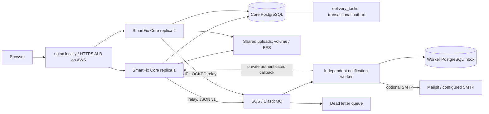

# SmartFix SWE5001 architecture

Baseline commit: `6cb329f4fe9b1f7e2e708b9ee00d81c456740fc0` (SWE5006 `main`). SWE5001 lives on `swe5001-cloud-native`.

## Logical architecture

## DDD and data ownership

Identity & Access owns users, role checks, credentials and login revocation. Maintenance Requests owns request lifecycle, status history and attachments. Dispatch owns assignments and selection rules; Work Management owns work orders and completion. Facility Catalogue supplies location identities. These remain bounded contexts inside Core, with existing application services and local transactions. Do not claim they have been extracted as separate network services.

Notification Delivery is extracted as an independent process, image, dependency set and deployable service. It owns its inbox/idempotency records and external-delivery execution. A task/recipient/reference id crossing the boundary is an opaque reference; Worker never queries the Core database. Core retains the delivery intent and the in-app notification projection because its existing UI and access rules consume that model. The Worker database is physically separate locally. AWS shares an RDS instance to reduce teaching-demo cost but uses separate databases and credentials with public CONNECT revoked. This is an intentional shared infrastructure failure domain.

## Consistency and failure handling

Business mutations and delivery_tasks insertions commit atomically using existing BEFORE_COMMIT listeners. Distributed mode disables the original in-process dispatcher. Multiple Core relays select due rows using PostgreSQL FOR UPDATE SKIP LOCKED. Successful SQS publish moves the row to QUEUED; queue failures preserve PENDING with exponential backoff capped at 300 seconds. Each batch is limited to ten rows. Queue retry attempts do not imply successful business delivery.

SQS standard queues can duplicate and reorder messages. Worker inserts the task identity and payload digest into its own database, locks that row, performs delivery and calls Core. Core locks the original delivery task, checks dedupKey, derives notification content itself and inserts the read model in the same transaction as completion. Worker commits its inbox before deleting the SQS message. A lost acknowledgement or crash after callback is safe to replay; Core's unique key prevents a second in-app notification. A publish-success/database-commit failure is accepted while Core still has PENDING intent. There is no exactly-once or global ordering claim.

Core unavailability or Worker DB failure leaves the SQS message unacknowledged; visibility timeout is 120 seconds. After five failed receives the queue moves it to DLQ. Fix the cause, then run the explicit replay tool. Poison payloads are rejected by schema validation. Queued intents remain visible as QUEUED while messages await processing/DLQ replay; the legacy admin retry action does not automatically replay SQS DLQ entries.

SMTP is optional and disabled in Core by default. If enabled, the Worker sends mail from the captured address. A crash after SMTP accepts mail can produce a duplicate email; stable Message-ID is useful for correlation but is not a guaranteed email-provider deduplication mechanism. Do not claim exactly-once email. The primary demonstrated path is asynchronous in-app delivery.

## Physical AWS architecture

Two availability zones contain a public ALB and Fargate tasks. Tasks have public IPs solely for outbound ECR/SQS/CloudWatch access, avoiding NAT Gateway cost. Security groups admit Core requests only from ALB and application tasks. Core's private Cloud Map name is used by Worker callbacks; the public ALB rejects internal and actuator routes. Database and EFS mount targets are private. HTTPS requires an existing ACM certificate and DNS name. ALB health checks reach management port 8081 directly.

Managed services: ECS Fargate, ECR, RDS PostgreSQL, SQS+DLQ, EFS, Secrets Manager, CloudWatch and Cloud Map. RDS/EFS/SQS encrypt data at rest. JDBC uses TLS and EFS uses transit encryption. Internal HTTP callbacks are restricted to the VPC/security group and bearer authenticated; service-to-service TLS is a future hardening step. Task IAM roles restrict Core to send and Worker to consume one queue. Only the one-off initialization task can read RDS master credentials.

## ADR-5001-001: Incremental service extraction

Keep existing workflow contexts in Core and extract delivery first. This preserves the user-visible application while establishing a real asynchronous process/data boundary. Four-way Request/Dispatch/Work Order extraction would require distributed transaction redesign within the five-day presentation window. Describe the result as a two-service MVP with bounded contexts, not four implemented microservices.

## ADR-5001-002: SQS plus transactional outbox/inbox

SQS is managed and supports independent consumer scaling. Outbox avoids losing events between business commit and publication; inbox and Core projection unique keys tolerate duplicates. HTTP callbacks preserve Core ownership of UI data. Kafka, Kubernetes and distributed transactions are unnecessary for this workload.

## ADR-5001-003: Shared sessions and attachments

Spring Session JDBC replaces per-process login state in distributed mode. Existing user details are serializable and omit password hashes. The SessionAutoConfiguration exclusion keeps existing single-process test/baseline behavior; @EnableJdbcHttpSession activates only for distributed mode. Flyway creates the session tables. Shared local volume/EFS preserves the existing attachment storage API. The load balancer needs no sticky sessions. RDS session writes and EFS latency may limit throughput and must be measured.

## ADR-5001-004: Cloud demo cost and availability

Use one small RDS instance and no NAT Gateway; both reduce cost, at the expense of database HA and full physical independence. Core and Worker independently deploy and scale between one and four instances after activation; CPU target tracking uses 60%. Autoscaling configuration is prepared, not evidence that AWS scaling has occurred. Start with zero tasks to initialize database roles safely. No paid provisioning is performed by code pushes.

## Operations and sources

Local Prometheus discovers every Core/Worker IP via DNS. Core exposes HTTP timing, JVM/process memory/CPU and outbox counters/backlog on port 8081; Worker exposes process metrics, acknowledged messages, failures and latest successful poll on 9090. AWS enables Container Insights, queue metrics, dashboard and a DLQ alarm. No email/SNS destination is configured for the alarm; observe it in CloudWatch or add an approved destination.

- [AWS SQS duplicate-delivery behavior](https://docs.aws.amazon.com/AWSSimpleQueueService/latest/SQSDeveloperGuide/standard-queues-at-least-once-delivery.html)
- [Spring Session JDBC configuration/schema](https://docs.spring.io/spring-session/reference/configuration/jdbc.html)

分布式模式中的 SKIPPED 邮件任务是最终回执，界面和服务会拒绝用相同身份重试。先修复联系地址，后续新事件使用新任务；若需要重发历史已跳过邮件，应先实现新的投递身份/版本。Core 中旧的同步 drain 在分布式模式下关闭，管理员操作不会绕过独立 Worker。
